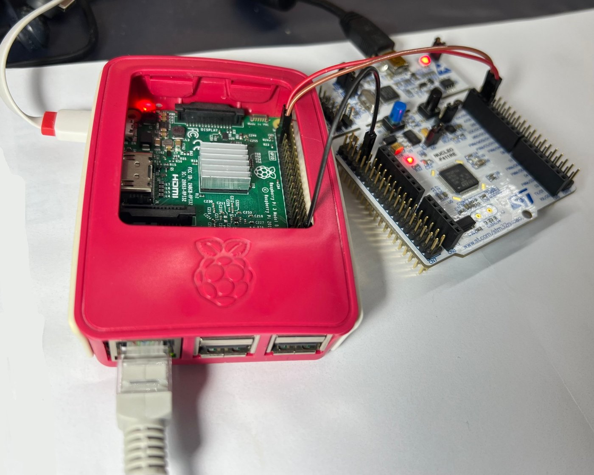

# zephyr-cmis-lite

[](https://github.com/hakanstar/zephyr-cmis-lite/actions/workflows/ci.yml)

CMIS-inspired I2C module management firmware on **Zephyr RTOS 4.5**, running on an
STM32 NUCLEO-F411RE that plays the role of a pluggable optical module, managed by a
Linux host (Raspberry Pi 3) over I2C.



*Raspberry Pi 3 as the I2C host (left) and NUCLEO-F411RE running the module firmware
(right), connected by SDA, SCL and GND.*

> **Scope:** this is a simplified subset *inspired by* CMIS (Common Management
> Interface Specification). It is **not** CMIS compliant. See
> [Simplifications](#simplifications-vs-cmis).

## What it does

- Exposes a **paged register map** at I2C address `0x50`: 128-byte lower memory plus
  128-byte upper pages selected through byte `0x7F` (page 00h identity, page 02h thresholds)
- Runs a **module state machine**: `RESET → LOW_PWR → PWR_UP → READY`, plus `FAULT`
- Samples the MCU **die temperature** and **VDDA** (via VREFINT) once per second
- **Latches alarms** against host-programmable thresholds, reports them through an
  IntL bit, and clears them on read
- Provides a **Zephyr shell** (`cmis ...`) for local inspection and fault injection
- Keeps the register map and state machine in a **platform-independent C core**,
  unit-tested with **ztest** on `native_sim` and run in **GitHub Actions** via Twister

## Architecture

```
               Raspberry Pi 3 (i2c-tools)
                        │ I2C @ 50 kHz, address 0x50
┌───────────────────────▼──────────────────────────────────────┐
│ NUCLEO-F411RE · Zephyr 4.5                                   │
│                                                              │
│  i2c_target.c (ISR callbacks)                                │
│    ├─ byte reads/writes ──► k_spinlock ──► cmis_core (C17)   │
│    └─ control write ──► k_msgq ──► command thread            │
│                                     └─ cmis_process()        │
│  sensor thread (1 s) ── die temp + VREFINT ──► monitors      │
│  shell (cmis ...)    ── peek / write / fault injection       │
│  main                ── heartbeat log                        │
└──────────────────────────────────────────────────────────────┘
lib/cmis_core/   no Zephyr headers; tested with ztest on native_sim
```

Design decisions:

- **`k_spinlock`, not `k_mutex`:** I2C target callbacks run in ISR context, where a
  mutex cannot be taken. Critical sections are a few byte operations.
- **No work in the ISR:** a write to the control register only sets a flag; on I2C
  STOP the callback posts to a `k_msgq`, and the command thread runs the state machine.
- **Side-effect-free `cmis_peek()`:** the STM32 driver can prefetch a byte that the
  host never clocks out. Clear-on-read is therefore applied only to the first byte of
  a read transaction; prefetched bytes use `cmis_peek()`. The shell also uses
  `cmis_peek()`, so local inspection never clears host-visible flags.

## Register map (v1.0)

**Lower memory (0x00–0x7F)**

| Addr | Name | Access | Content |
|---|---|---|---|
| 0x00 | Identifier | RO | `0x18` (QSFP-DD code in SFF-8024) |
| 0x01 | Revision | RO | `0x10` = this project's map v1.0 |
| 0x03 | ModuleState | RO | bits 3:1 state (1 LowPwr, 2 PwrUp, 3 Ready, 5 Fault); bit 0 = 1 when IntL deasserted |
| 0x08 | Latched flags | RO, clear on read | bit 0 TempHighAlarm, bit 1 TempLowAlarm, bit 2 VccLowAlarm |
| 0x0E–0x0F | Temperature | RO | s16 big-endian, 1/256 °C |
| 0x10–0x11 | Supply voltage | RO | u16 big-endian, 100 µV units |
| 0x1A | Module control | RW | bit 4 LowPwrRequestSW (default 1), bit 3 SoftwareReset (self-clearing) |
| 0x7F | Page select | RW | `0x00` or `0x02`; other values rejected |

**Page 00h (0x80–0xFF), identity, RO:** vendor name `0x81`, part number `0x94`,
serial number `0xA6` (16 bytes each, ASCII padded with spaces).

**Page 02h (0x80–0xFF), thresholds, RW:** TempHighAlarm `0x80` (default 75 °C),
TempLowAlarm `0x82` (−5 °C), VccLowAlarm `0x88` (3.0 V).

Multi-byte writes auto-increment the register address.

## State machine

```
RESET ──init──► LOW_PWR ──(LowPwrRequestSW=0)──► PWR_UP ──► READY
  ▲                ▲                                          │
  │                └──────(LowPwrRequestSW=1)─────────────────┘
  └──(SoftwareReset=1, from any state)
any state ──(sensor fault)──► FAULT   (left only via SoftwareReset)
```

## Repository layout

```
app/                Zephyr application (I2C target, threads, shell)
  boards/           nucleo_f411re overlay (ADC, die_temp, vref)
lib/cmis_core/      platform-independent register map + state machine
tests/cmis_core/    ztest suite (20 cases) for native_sim
west.yml            manifest: Zephyr v4.5.0, cmsis, cmsis_6, hal_stm32 only
.github/workflows/  CI: Twister build for nucleo_f411re + ztest on native_sim
```

## Build and test

Requires a Zephyr 4.5 workspace and Zephyr SDK 1.0.x (developed on Ubuntu 24.04 in WSL2).

```bash
# Fresh workspace from this manifest
west init -m https://github.com/hakanstar/zephyr-cmis-lite --mr main ws
cd ws && west update && west packages pip --install
west sdk install -t arm-zephyr-eabi
cd zephyr-cmis-lite

# Unit tests on native_sim
west twister -T tests -p native_sim

# Firmware
west build -b nucleo_f411re app
west flash -r openocd
```

## Hardware setup

| Raspberry Pi 3 | NUCLEO-F411RE (CN5) | Signal |
|---|---|---|
| Pin 6 | Pin 7 (GND) | GND |
| Pin 3 (GPIO2) | Pin 9 (D14 / PB9) | SDA |
| Pin 5 (GPIO3) | Pin 10 (D15 / PB8) | SCL |

Each board uses its own supply; only GND is shared. The Pi's on-board pull-ups are used.
Pi I2C speed is set to 50 kHz in `/boot/firmware/config.txt`:
`dtparam=i2c_arm=on,i2c_arm_baudrate=50000` (see [Known issues](#known-issues)).

## Demo (captured on hardware)

Identity and power-up from the Pi:

```
$ i2cget -y 1 0x50 0x00        # Identifier
0x18
$ i2cget -y 1 0x50 0x03        # LOW_PWR, IntL deasserted
0x03
$ i2cset -y 1 0x50 0x1a 0x00   # clear LowPwrRequestSW
$ i2cget -y 1 0x50 0x03        # READY
0x07
$ i2cdump -y 1 0x50
...
80: 00 53 54 41 52 20 4c 41 42 53 20 20 20 20 20 20    .STAR LABS
90: 20 00 00 00 43 4d 49 53 2d 4c 49 54 45 2d 30 31     ...CMIS-LITE-01
a0: 20 20 20 20 00 00 53 4e 30 30 30 31 20 20 20 20        ..SN0001
```

Firmware log for the same transition (50 ms simulated power-up time):

```
[00:19:05.858,000] <inf> module: state LOW_PWR -> PWR_UP
[00:19:05.908,000] <inf> module: state PWR_UP -> READY
```

Live monitors and a host-triggered alarm:

```
$ i2ctransfer -y 1 w1@0x50 0x0e r4     # temp + VCC, one auto-increment read
0x1a 0x60 0x82 0x00                    # 26.4 C, 3.328 V
$ i2cset -y 1 0x50 0x7f 0x02           # page 02h
$ i2cset -y 1 0x50 0x80 0x14 0x00 i    # TempHighAlarm = 20.0 C
$ i2cget -y 1 0x50 0x03                # READY, IntL ASSERTED
0x06
$ i2cget -y 1 0x50 0x08                # TempHighAlarm latched (cleared by this read)
0x01
```

Fault handling from the shell:

```
uart:~$ cmis fault on
[00:00:31.017,000] <wrn> module: sensor fault set
[00:00:31.017,000] <inf> module: state READY -> FAULT
uart:~$ cmis fault off
uart:~$ cmis lowpwr off
uart:~$ cmis status
state       : FAULT (reg 0x03 = 0x0b, IntL deasserted)
uart:~$ cmis reset
[00:00:58.141,000] <inf> module: state FAULT -> RESET
[00:00:58.192,000] <inf> module: state RESET -> LOW_PWR
uart:~$ cmis write 0x00 0x55
write 0x00 <- 0x55 rejected (-1)
```

## Known issues

- **`west flash` exits with status 1 over usbip/WSL2.** The image is written
  correctly (verified by the new firmware booting), but OpenOCD 0.12 fails to read
  DBGMCU after the post-flash reset with the on-board ST-LINK V2J48 firmware. Updating
  the ST-LINK firmware is the likely fix; not yet attempted.
- **Raspberry Pi I2C and clock stretching.** The BCM2835 I2C controller has a known
  problem with targets that stretch SCL, which the STM32 does in interrupt-driven
  target mode. The bus runs at 50 kHz as a precaution; no corruption was observed at
  that speed, including full `i2cdump` reads.

## Simplifications vs CMIS

- Only lower memory, page 00h and page 02h; no banks, no CDB, no data path or lane control
- Page 02h thresholds are **writable** here (read-only in CMIS) to allow host-driven alarm demos
- Only alarm flags for temperature and VCC; no warnings, no per-lane flags, no masks
- Entering FAULT does not assert IntL (a real module would raise a fault flag)
- Identifier `0x18` is used only as a familiar value; the map is not a QSFP-DD memory map
- Monitors are the MCU's on-chip sensors, standing in for module sensors

## License

Apache-2.0
